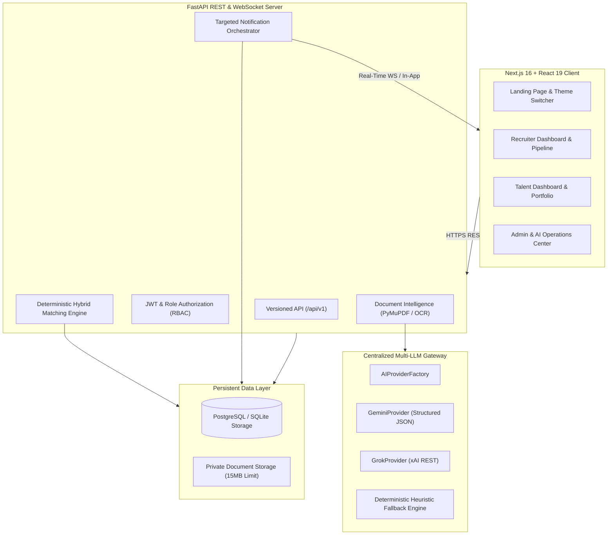

# NEXORA Architecture & System Specification

## 1. System Overview
NEXORA is a production-oriented AI-powered developer recruitment, talent discovery, and portfolio platform designed to eliminate keyword stuffing and noisy candidate pipelines. It combines a provider-independent AI intelligence system (Google Gemini & xAI Grok) with a deterministic, explainable 5-pillar hybrid matching engine.

## 2. Core Pillars & Architecture
1. **Provider-Independent AI Architecture**:
   - `BaseAIProvider` abstract adapter interface
   - `GeminiProvider`: Google Gemini 1.5 Pro / Flash via REST structured JSON mode
   - `GrokProvider`: xAI Grok via REST OpenAI-compatible specification
   - `HeuristicProvider`: Offline deterministic extractor ensuring 100% operational readiness without API keys
   - `AIProviderFactory`: Instantiates configured provider based on `AI_PROVIDER`
   - `AIOrchestrator`: Coordinates document requirement extraction, profile analysis, project relevance, and audit logging.

2. **Deterministic Hybrid Matching Engine**:
   - **Mandatory Skill Alignment (40%)**: Non-negotiable required technical skills. Functions as a strict eligibility gate. Missing mandatory skills marks the candidate as ineligible.
   - **Preferred Skill Alignment (20%)**: Bonus technical competencies.
   - **Relevant Portfolio Projects (20%)**: Evaluates demonstrated repository and problem-solving overlap.
   - **Experience Range Alignment (10%)**: Compatibility with minimum and maximum experience criteria.
   - **Availability & Work Mode (10%)**: Remote, Hybrid, or On-site preference alignment.

3. **Targeted Notification System**:
   - Only eligible candidates whose match score equals or exceeds the threshold (`MATCH_THRESHOLD=75%`) receive recruitment notifications when a job is published.
   - Prevents candidate spam and ensures recruiters receive applications only from qualified developers.
