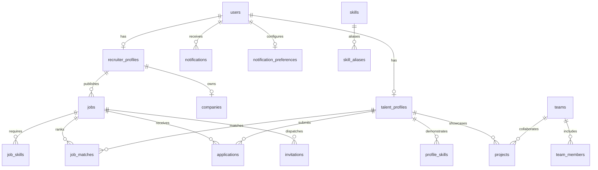

# NEXORA Database Schema & Data Models

## 1. Overview
NEXORA utilizes a normalized relational data model managed via SQLAlchemy with full SQLite and PostgreSQL compatibility. Foreign keys, cascading deletions, unique constraints, and indexes are enforced.

## 2. Table Catalog
- `users`: ID, email, hashed_password, role (`recruiter`, `talent`, `admin`), talent_type (`developer`, `student`, `team`), is_active, timestamps.
- `recruiter_profiles`: User reference, full_name, designation, phone.
- `companies`: Recruiter reference, name, logo_url, website, size, industry, location, description, social_links.
- `talent_profiles`: User reference, name, headline, bio, specialization, location, education, experience_years, availability, preferred_employment_type, remote_preference, compensation_expectation.
- `teams`: Lead user reference, name, slug, description, website, github_url, availability.
- `team_members`: Team reference, talent profile reference, role (`Lead`, `Member`), title.
- `skills`: Canonical name, category (`Frontend`, `Backend`, `Database`, `AI`, `Tools`, `Embedded`), is_verified.
- `skill_aliases`: Skill reference, alias synonyms.
- `profile_skills`: Profile reference, skill reference, proficiency, experience_years, evidence_url, source.
- `projects`: Profile / team reference, title, description, problem_statement, features, developer_contribution, github_url, demo_url, status.
- `project_technologies`: Project reference, skill reference, usage_level (`demonstrated`, `mentioned`).
- `jobs`: Recruiter & company references, title, category, description, employment_type, work_mode, location, compensation_range, experience_min, experience_max, openings, deadline, strict_eligibility, status (`draft`, `published`, `paused`, `closed`).
- `job_skills`: Job reference, skill reference, is_mandatory (Boolean), importance_weight.
- `job_matches`: Job reference, talent reference, match_score (0-100), eligibility (`eligible`, `ineligible`), matched_mandatory_skills, missing_mandatory_skills, matched_preferred_skills, missing_preferred_skills, relevant_projects, score_breakdown, explanation, algorithm_version.
- `applications`: Job reference, talent reference, status (`applied`, `under_review`, `shortlisted`, `interview`, `selected`, `rejected`), cover_note, recruiter_notes, interview_date.
- `invitations`: Job reference, recruiter reference, talent reference, status (`pending`, `accepted`, `declined`), message.
- `notifications`: User reference, type, title, message, link, is_read, metadata_json.
- `notification_preferences`: User reference, email_enabled, in_app_enabled, min_match_score.
- `uploaded_documents`: User reference, filename, file_path, file_size, mime_type, doc_type, status.
- `document_extractions`: Document reference, raw_text, structured_data, confidence, review_required, approved_by_user.
- `ai_usage_logs`: Provider, model, task_type, prompt_tokens, completion_tokens, latency_ms, status, error_details.
- `audit_logs`: User reference, action, target_type, target_id, ip_address, details.
